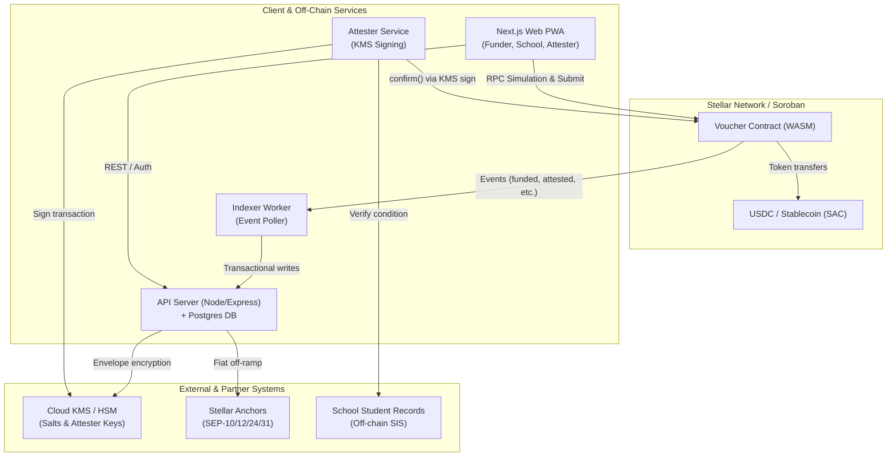
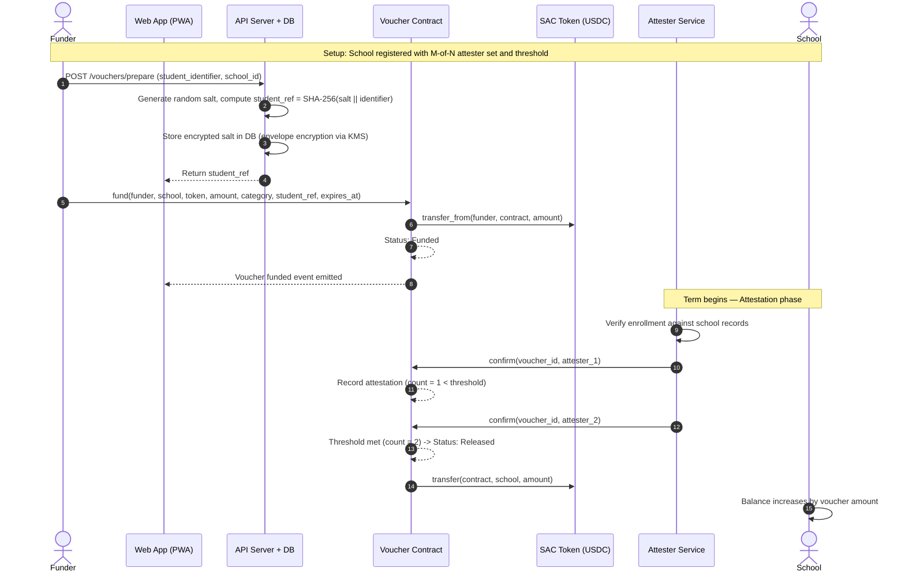
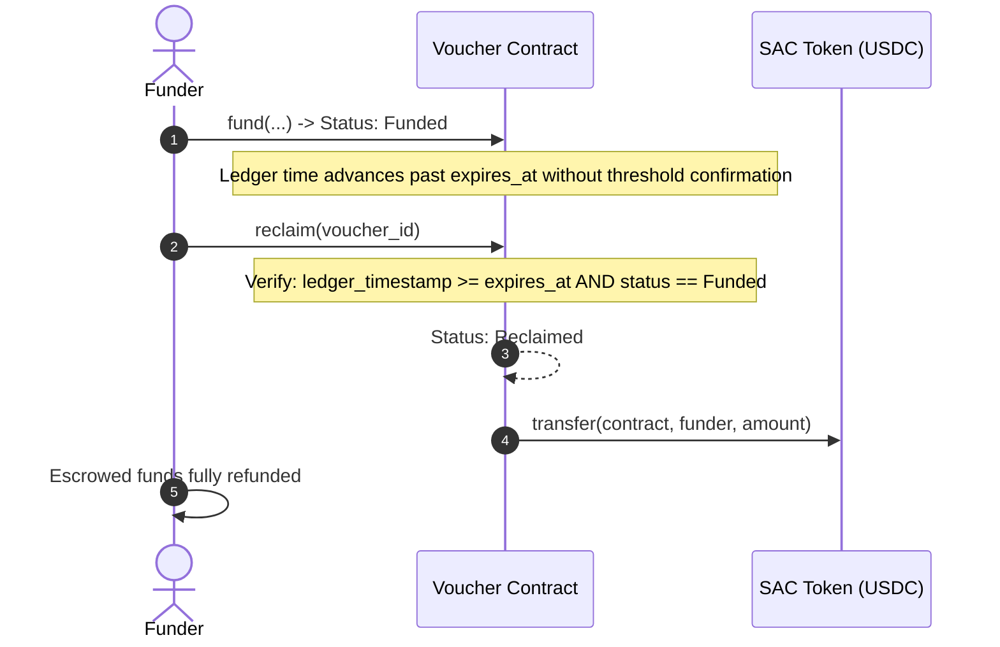
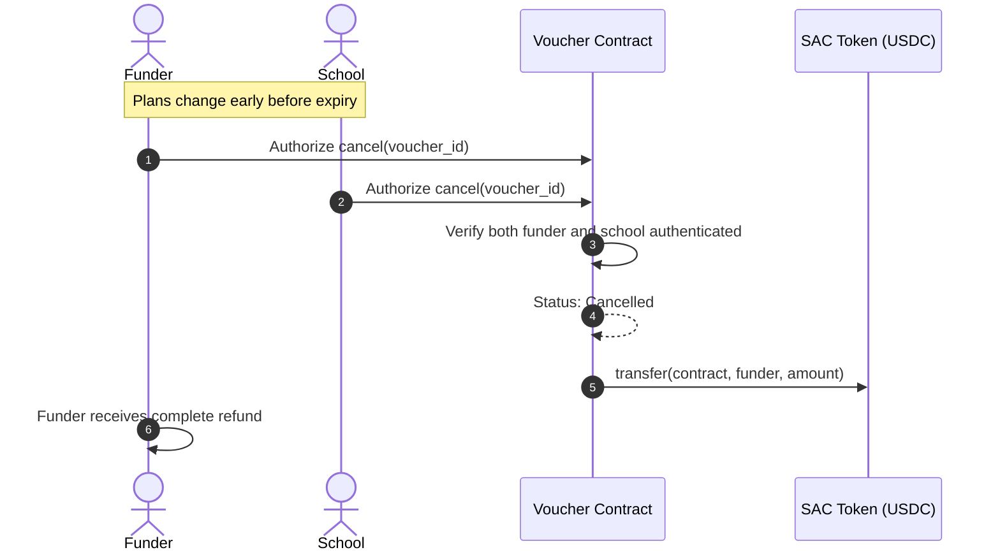
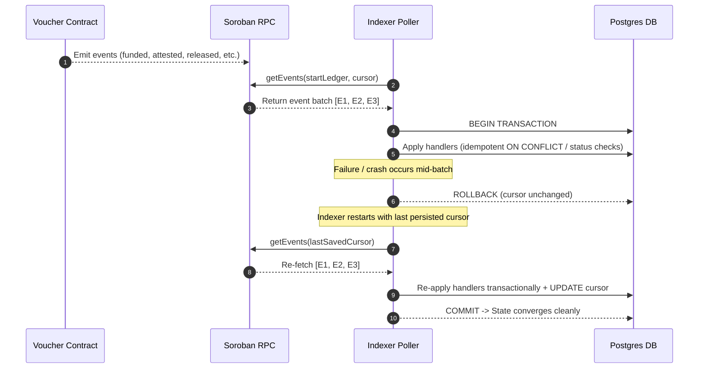

# Tuition Escrow — System Architecture

This document describes the technical architecture, component interactions, scenario data flows, and trust boundaries of Tuition Escrow, based strictly on the specification in `README.md`.

---

## 1. System Overview

Tuition Escrow enables purpose-bound school fee payments on Stellar. Escrowed tokens are locked in a Soroban smart contract and released to a school only when authorized attesters confirm the condition (such as enrollment) has been met. If conditions are not met, the funder recovers their funds after expiry.

### Architecture Diagram

```
                   ┌─────────────────────────────────────────────┐
                   │                  Stellar network            │
                   │                                             │
                   │   ┌───────────────────────────────────┐     │
                   │   │  Voucher contract (Soroban/WASM)  │     │
                   │   │  fund · confirm · reclaim · cancel│     │
                   │   └───────────────┬───────────────────┘     │
                   │                   │ token interface (SAC)   │
                   │   ┌───────────────▼───────────────────┐     │
                   │   │  USDC / stablecoin (Stellar asset)│     │
                   │   └───────────────────────────────────┘     │
                   └───────▲─────────────────▲──────────▲────────┘
                           │ RPC             │ events   │ RPC
          ┌────────────────┴───┐    ┌────────┴─────┐   ┌┴─────────────────┐
          │      Web app       │    │   Indexer    │   │ Attester service │
          │ (funder/school/    │    │ (getEvents → │   │ (KMS-backed      │
          │  attester views)   │    │  Postgres)   │   │  signing)        │
          └─────────┬──────────┘    └──────┬───────┘   └────────┬─────────┘
                    │ REST/GraphQL         │                    │
                    └──────────┬───────────┴────────────────────┘
                               │
                       ┌───────▼────────┐        ┌──────────────────────┐
                       │   API server   │◄──────►│  School records (off │
                       │   + Postgres   │        │  chain, per school)  │
                       └───────┬────────┘        └──────────────────────┘
                               │
                    ┌──────────▼───────────┐
                    │  Anchors (SEP-10/12/ │
                    │  24/31) fiat ramps   │
                    └──────────────────────┘
```



---

## 2. Core Architectural Principles

1. **The chain enforces rules, not facts:** The smart contract guarantees that funds are held securely and released only upon valid attestation or returned to the funder after expiry. It does not inspect off-chain school records directly; trust lives in the independent attester model.
2. **Minimize on-chain data:** No student personal identifiable information (PII) ever touches the ledger. Vouchers contain only an opaque 32-byte salted hash (`student_ref`) and a coarse fee category code.
3. **Small, auditable contract:** Escrow state transitions are minimal and fail-closed. Off-chain services handle indexing, attestation workflow, and UI.
4. **Funds never rest with the platform:** Platform operators hold no custody of escrowed funds. Tokens are held directly by the Soroban contract.
5. **Fail-closed operations:** At the exact second of voucher expiry, attestation fails (`AlreadyExpired`) and funder reclaim succeeds. If an attester service or indexer is unavailable, funders reclaim unreleased funds.

---

## 3. Data Flow per Scenario

### Scenario 1: Setup & Happy Path (Fund → Threshold Attestations → Release)



### Scenario 2: Expiry Path (Fund → No Attestation → Expiry → Reclaim)



### Scenario 3: Cancel Path (Mutual Cancellation Before Expiry)



### Scenario 4: Attack Attempts & Rejections

- **Non-Attester Confirm:** Unauthorized caller attempts `confirm(voucher_id)`. Contract verifies caller is in voucher's snapshotted attester set; fails immediately with `NotAuthorized`.
- **Early Reclaim:** Funder calls `reclaim(voucher_id)` while `ledger_timestamp < expires_at`. Contract rejects with `NotExpired`.
- **Double Attestation:** Attester attempts to call `confirm` twice. Contract rejects with `DuplicateAttestation`; vote is not counted twice.
- **Release to Wrong Party:** Contract release logic strictly transfers tokens to `voucher.school` (immutable payee). There is no parameter or code path allowing arbitrary destination addresses.

### Scenario 5: Indexer Ingestion & Recovery



### Scenario 6: Student Privacy Mapping Flow

1. **Client Submission:** The funder enters the student identifier (e.g., student ID number) in browser memory.
2. **Envelope Encryption:** The API generates a cryptographically secure random 32-byte salt, calculates `student_ref = SHA-256(salt || identifier)`, and encrypts the salt using a KMS data key.
3. **On-chain Isolation:** Only `student_ref` and a coarse category code are submitted on-chain.
4. **School Authorization:** Only authenticated administrators belonging to the specific school can call `GET /schools/:id/vouchers/:id/mapping` to decrypt the student identifier. Public users and funders receive 403 Forbidden.

---

## 4. Trust Boundaries

```
┌────────────────────────────────────────────────────────────────────────┐
│ PUBLIC / UNTRUSTED ZONE                                                │
│ Web Browsers, Public Networks, External Funders                         │
└───────────────────────────────────┬────────────────────────────────────┘
                                    │ HTTPS / RPC (TLS)
┌───────────────────────────────────▼────────────────────────────────────┐
│ PLATFORM / OPERATIONAL BOUNDARY                                        │
│ API Server (Non-custodial, No signing keys, JWT Role Checks)            │
│ Indexer (Read-only event consumer, idempotent Postgres updates)        │
│ KMS (Holds envelope master keys; raw keys never leave hardware)        │
└──────────────────┬─────────────────────────────────┬───────────────────┘
                   │ Authenticated RPC               │ Pinned SDK / KMS
┌──────────────────▼───────────────────┐ ┌───────────▼───────────────────┐
│ SCHOOL TRUST BOUNDARY                │ │ ATTESTER TRUST BOUNDARY       │
│ - Owns student SIS records           │ │ - Independent signing account │
│ - Accesses decrypted student mapping │ │ - Authorized ONLY to confirm  │
│ - Destination of released tokens     │ │ - Tamper-evident audit logs   │
└──────────────────────────────────────┘ └───────────────────────────────┘
                   │                                 │
┌──────────────────▼─────────────────────────────────▼───────────────────┐
│ BLOCKCHAIN CONSENSUS BOUNDARY (Stellar Soroban)                        │
│ - Smart Contract holds tokens in escrow; enforces invariants           │
│ - Admin keys CANNOT withdraw escrowed funds to arbitrary addresses    │
│ - Released funds can ONLY go to voucher.school                         │
│ - Fail-closed: unconfirmed vouchers refund to funder on expiry         │
└────────────────────────────────────────────────────────────────────────┘
```

### Summary of Component Privileges

| Component            | Can Move Funds?                              | Can Decrypt Student Data?        | Holds Private Signing Keys? |
| -------------------- | -------------------------------------------- | -------------------------------- | --------------------------- |
| **Voucher Contract** | Yes (Escrow holder, strictly per code logic) | No (Never receives student data) | No (Executes on Soroban VM) |
| **Funder Client**    | Only deposit & reclaim after expiry          | No (Mapping belongs to school)   | Only funder wallet key      |
| **School Dashboard** | Receives release; co-signs cancel            | Yes (Only for its own students)  | School wallet key           |
| **Attester Service** | Only signs `confirm` if condition met        | No (Verifies boolean outcome)    | KMS-backed attester key     |
| **Platform API**     | **NO** (Zero custody, cannot move funds)     | Only encrypted blobs via KMS     | No wallet signing keys      |
| **Indexer**          | **NO** (Read-only event ingest)              | No                               | No                          |
